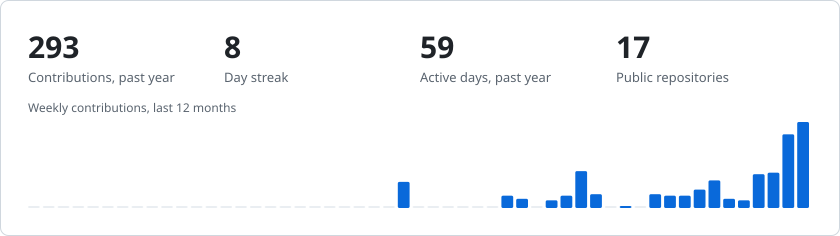
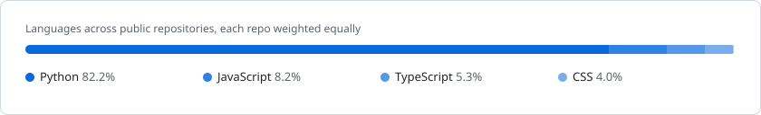

# Cole Rodney Migisha

**Machine learning, data and automation.** I build systems that take messy data, make sense of it, and put a clean interface on top.

Computer Science, Uganda Christian University · AI and Robotics track · Mukono, Uganda

> **Open to internships and entry-level roles** in machine learning, data engineering and automation. The quickest way to reach me is [email](mailto:crmigisha@gmail.com).

## About

I'm a <!-- age:start -->22<!-- age:end -->-year-old Ugandan who grew up asking nosy questions. How does a TV broadcast end up in your living room? How does a bank know what's in your account? Nearly everything I loved led back to a computer, and I couldn't pick just one corner of it, so I picked computer science.

I'm in my third year of this Bachelors of Science  at Uganda Christian University, on the AI and Robotics track, with data science alongside it (you can't perfect automation without understanding the data underneath it). Current CGPA: **4.73 / 5**.

My work usually starts with a reason, and the next few hours are me making sure I don't lose sight of it while the thing takes shape. I care about *why* something works, and I like finishing the job: a model that goes live behind a dashboard, not one that stays in a notebook.

## What I bring

- **Machine learning.** Feature engineering and classical models on messy, real-world data (scikit-learn, LightGBM), and computer vision with PyTorch and OpenCV.
- **Data engineering.** Pipelines that turn separate, untidy sources into validated, analysis-ready tables, with pandas, Spark, DuckDB, Parquet and Airflow, and tests that prove it.
- **Automation.** Scheduled jobs and small services that keep running when nobody is watching, built on GitHub Actions, FastAPI and the APIs of the tools people already use.
- **Interfaces and design.** React and PySide6 on the front, and Figma, Illustrator and Inkscape for the visuals. I care about how the work looks as much as how it runs.

## Experience

| Role | Where | When |
|---|---|---|
| **IT Intern** | Uganda Civil Aviation Authority, Entebbe | Apr – Aug 2026 |
| **Public Relations Manager** | Honours College, Uganda Christian University | Nov 2025 – Nov 2026 |
| **Class Representative** | Computer Science, Uganda Christian University | Current |
| **Web Designer and Manager (Intern)** | Makerere University Innovation Pod | Feb – Sep 2024 |

At the Civil Aviation Authority I built a web-based passenger complaints system that brings passengers, service providers and Authority staff into one workflow, plus a Java replica of the airport operational database for practising flight record amendments.

## Recognition

- **Bronze Honour**, International Youth Math Challenge 2025
- **National mathematics camp invite**, where the country's top 100 students were tested to pick a team of 15
- **Africa's Talking hackathon**, where my team built NetDoctor, a network diagnostics platform. I owned testing and quality.

## Recently active

<!-- recent:start -->
- [`portfolio`](https://github.com/coleRodneyMigisha/portfolio) · my portfolio 10 Nov 2026
- [`airqo_cole_charis_assgnmnt`](https://github.com/coleRodneyMigisha/airqo_cole_charis_assgnmnt) 9 Nov 2026
- [`cv_project_LipScribe`](https://github.com/coleRodneyMigisha/cv_project_LipScribe) 9 Nov 2026
- [`deepvision-study-frontend`](https://github.com/coleRodneyMigisha/deepvision-study-frontend) 8 Nov 2026
<!-- recent:end -->

## Stack

**Languages** 

**Machine learning and data** 

**Backend, frontend and tooling** 

**Design** 

Currently learning: Docker, MLflow and cloud deployment.

## GitHub activity

<picture>
  <source media="(prefers-color-scheme: dark)" srcset="assets/stats-dark.svg">
  
</picture>

<picture>
  <source media="(prefers-color-scheme: dark)" srcset="assets/languages-dark.svg">
  
</picture>

## Beyond the code

My faith in Christ shapes how I work and how I treat people. 

---

Age, recent activity and the activity cards refresh daily through a [GitHub Action](.github/workflows/refresh.yml). Last refreshed <!-- updated:start -->10 November 2026<!-- updated:end -->.
